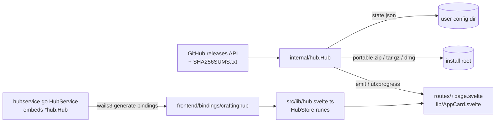

# Repository Guidelines

## Project Overview
Crafting Apps Hub: a Wails v3 (`v3.0.0-beta.28`) desktop launcher that installs, updates, uninstalls and launches seven Craft apps published as GitHub releases under `github.com/storytold/*` (photocraft, vectorcraft, filmcraft, lightcraft, pdfcraft, effectcraft, designcraft). Backend is Go. Frontend is SvelteKit 3 + Svelte 5, styled with Tailwind 4 + Skeleton 5 + Lucide icons, and built with bun.

## Architecture & Data Flow

- `internal/hub/` is pure Go and contains no Wails imports, so it can be unit-tested without the runtime.
  - `catalog.go`: static `Catalog`. `App.Asset` is the release file prefix and executable name. **pdfcraft ships as `printcraft`.**
  - `release.go`: GitHub client (`latestRelease`, `apiBase` var as test seam, `GITHUB_TOKEN` honored), `pickAsset` (OS/arch → asset; portable builds only, never MSI/deb/rpm), `parseSums`, `newerVersion`.
  - `extract.go`: zip / tar.gz with zip-slip guard (`safeJoin`), dmg via `hdiutil` + `ditto` (macOS only), `findExecutable`.
  - `hub.go`: `Hub` holds the mutex-protected state. `Install` handles both install and update: download → hash while streaming → verify checksum → extract to `<root>/.tmp-*` → rename-swap with rollback. `Uninstall(id, clean)`, `Launch` (detached), `Refresh` (parallel `wg.Go`).
  - `datadirs.go`: resolves `App.Data` (per-app settings/recovery/cache folders, traced from each app's Rust source) against `baseDirs` (`config`/`data`/`cache`/`temp`; `h.base` is the test seam). Only existing folders are returned, as `AppState.DataDirs`. When an app changes where it stores data, update `App.Data` in `catalog.go`. Never add folders that hold user work.
  - Portable data: `App.Portable` names a folder an app keeps next to its exe (only PhotoCraft: `PhotoCraftData`, enabled by the `portable.txt` its Windows zip ships). Every archive has a versioned top folder, so the exe directory changes on each update. `keepPortable` moves the folder into the new tree before the swap is final. `removeInstall` keeps it at `<install dir>/<Portable>` unless clean. `findPortable` looks at depth 0 and 1. A new app that writes beside its exe MUST set `Portable`, or updates will wipe its settings.
- `hubservice.go` (package main) embeds `*hub.Hub` so all its exported methods are bound, and adds Wails-dependent methods (`ChooseInstallRoot` dialog, `OpenInstallDir` file manager) via `application.Get()`.
- `main.go` resolves dirs (`dirs()`), wires `emit` → `app.Event.Emit("hub:progress", p)`, and registers `application.RegisterEvent[hub.Progress]("hub:progress")` for typed TS events.
- Frontend: client-only SPA (`ssr = false`). `HubStore` (a class with `$state`/`$derived` fields) is the single store. It calls bindings, listens to `Events.On("hub:progress")`, and reports via the shared Skeleton `toaster`. The backend `AppState` is the source of truth: each mutating call returns the new `AppState`, which replaces the entry in `hub.apps`.

## Key Directories
| Path | Purpose |
|---|---|
| `internal/hub/` | Install/update engine + tests |
| `frontend/src/lib/` | `hub.svelte.ts` (store, toaster, `formatBytes`), `AppCard.svelte` |
| `frontend/src/routes/` | `+layout.svelte` (CSS + `Toast.Group`), `+page.svelte` (rail nav, grid, dialogs), `layout.css`, `+layout.ts` |
| `frontend/static/icons/` | `<app id>.png` icons copied from each repo's `assets/app-icon/hicolor/256x256` (MIT/Apache, see `LICENSE.txt`) |
| `frontend/bindings/` | **Generated**; never hand-edit |
| `build/` | Taskfiles per platform, installer assets, `config.yml` |

## Development Commands
```sh
wails3 dev                                  # Go rebuild + Vite :9245 + app
wails3 build                                # bin/wails-crafting-apps-hub(.exe)
wails3 task package                         # platform installer
wails3 task common:generate:bindings        # after changing any exported Go method/type on HubService or hub.Hub
go test ./internal/...                      # backend tests (httptest fake GitHub)
go vet ./...
cd frontend && bun run check                # svelte-kit sync + svelte-check (must be 0 errors/warnings)
go build -tags server -o bin/hub-server . && WAILS_SERVER_PORT=8765 ./bin/hub-server
                                            # real backend + UI in a browser at :8765 (handy for UI checks)
```
For smoke tests, isolate state: set `APPDATA` / `LOCALAPPDATA` (Windows) or `HOME` / `XDG_CONFIG_HOME` to a temp dir.

## Code Conventions & Common Patterns
- **Adding an app**: append to `hub.Catalog` (verify the asset prefix against a real release) and add `frontend/static/icons/<id>.png`. Nothing else is needed.
- **Go errors**: return user-readable `error` values. They reach the JS promise rejection and are shown in toasts via `errText`. Wrap with `%w`. Never install without a checksum match.
- **Locking**: `h.mu` guards `st`, `releases`, `relErr`, `busy`. Do network and disk I/O outside the lock (see `Install`). `saveLocked` writes atomically (tmp + rename).
- **Context**: long calls take `ctx context.Context` first. Wails cancels it when the JS `CancellablePromise` is cancelled.
- **Svelte 5 runes only** (`$state`, `$derived`, `$props`, `onclick=`). Skeleton components use the composed pattern plus the data-in/event-out pattern (`open` + `onOpenChange`), not `bind:`.
- **Imports**: SvelteKit 3 has no `$lib`. Use package.json subpath imports with explicit extensions: `#lib/hub.svelte.ts`, `#bindings/craftinghub/index.ts`, `#bindings/craftinghub/internal/hub/models.ts`.
- **Icons**: per-icon imports, `import PlayIcon from "@lucide/svelte/icons/play"`, sized with `class="size-4"`.
- **Styling**: Tailwind utilities + Skeleton classes (`btn`, `btn-icon`, `card`, `badge`, `preset-filled-*-500`, `preset-tonal`, `field-group`, `input`, `h1`–`h6`, `bg-surface-50-950`). Theme is `cerberus` (`data-theme` on `<html>`). Dark mode uses the `.dark` class (custom variant in `layout.css`) and is persisted in `localStorage.mode`.
- Skeleton docs for LLMs: https://www.skeleton.dev/llms-svelte.txt (v5 renamed classes, e.g. `input-group` → `field-group`).
- Inline one-expression helpers unless they have 3+ callers.

## Important Files
- `main.go`: app bootstrap, `dirs()` (data dir `<UserConfigDir>/CraftingAppsHub`; install root `%LOCALAPPDATA%\Programs\CraftingApps` | `~/Applications/Crafting Apps` | `~/.local/share/crafting-apps`).
- `frontend/vite.config.ts`: plugin order `tailwindcss()`, `sveltekit({adapter})`, `wails("./bindings")`. SvelteKit config lives here (no `svelte.config.js` in Kit 3).
- `frontend/tsconfig.json`: must extend `$app/tsconfig`.
- `frontend/package.json`: `imports` map for `#lib/*` and `#bindings/*`.
- `build/config.yml`: product metadata. After editing `info`, run `wails3 task common:update:build-assets`. MSIX XML under `build/windows/msix/` is not regenerated, so edit it by hand.

## Runtime/Tooling Preferences
- **bun only** (`bun add -d`, `bun run`). Commit `frontend/bun.lock`. `frontend/bunfig.toml` enforces a 7-day `minimumReleaseAge`.
- Go module is `craftinghub` (bindings dir name follows it). Go 1.25+, `wails3` CLI beta.28, Task v3.
- Production builds use `-tags production`; server mode uses `-tags server`.
- `build:frontend` and `generate:bindings` are `run: once` to avoid races in parallel builds. Keep it that way.

## Testing & QA
- `internal/hub/hub_test.go` covers asset picking per OS/arch (including the printcraft prefix and the arm64→x64 fallback), numeric version ordering, sums parsing, zip-slip rejection, a full install → refresh → update → restart-persistence → uninstall cycle against an `httptest` fake GitHub, checksum mismatch preserving the previous install with no leftover temp dirs, clean uninstall (plain keeps data; clean removes only mapped folders, including legacy `PrintCraft` ones, and leaves lookalike/sibling folders alone), and PhotoCraft portable data surviving update → failed update → plain uninstall → reinstall, then being removed by clean uninstall. Tests always override `h.base` so they never touch the real profile.
- No frontend unit tests. Verify UI changes by running `bun run check`, then exercising the server-mode build in a browser. Install FilmCraft (≈32 MB, the smallest) for a real download test. Use `GITHUB_TOKEN=$(gh auth token)`, because repeated smoke runs exhaust the 60/h anonymous API limit. `go build` can serve a stale embedded `frontend/dist`: after a frontend rebuild, use `go build -a` or check the served `nodes/2.*.js` hash, and make sure no old `hub-server.exe` still holds the port.
- No CI or lint config. Use `gofmt` and `go vet`. The `build/ios/*.go` template files are not gofmt-clean upstream; leave them.
