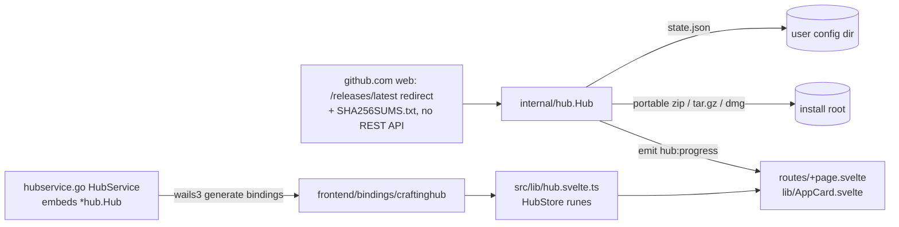

# Repository Guidelines

## Project Overview
Crafting Apps Hub: a Wails v3 (`v3.0.0-beta.28`) desktop launcher that installs, updates, uninstalls and launches thirteen Craft apps published as GitHub releases under `github.com/storytold/*` (photocraft, lightcraft, vectorcraft, designcraft, figcraft, cadcraft, filmcraft, effectcraft, soundcraft, wordcraft, gridcraft, deckcraft, pdfcraft). Backend is Go. Frontend is SvelteKit 3 + Svelte 5, styled with Tailwind 4 + Skeleton 5 + Lucide icons, and built with bun.

## Architecture & Data Flow

- `internal/hub/` is pure Go and contains no Wails imports, so it can be unit-tested without the runtime.
  - `catalog.go`: static `Catalog`. `App.Asset` is the release file prefix and executable name (pdfcraft was `printcraft` before v0.4.0; its legacy data folders stay in `Data`). `App.Group` is the UI section heading; keep each group's entries contiguous in `Catalog`, because the UI renders sections in first-seen order. `App.Extensions` lists the document types the app opens (lowercase, no leading dot), mirrored from each app's `packaging/macos/Info.plist.in`, `.desktop` `MimeType` and open-dialog/argv list; `SetDefaultApp` registers them. Leave it empty for an app that does not accept a file path on launch.
  - `release.go`: release discovery **without the REST API** (no rate limit, no token). `latestRelease` reads the tag from the `/releases/latest` 302 (`noRedirect` client), then fetches `SHA256SUMS.txt`. Its entries are both the asset list and the checksums (`Release.Sums`). A release without it is an error. `assetSize` does one HEAD for the UI size, reused while the tag is unchanged (`withSize`). `ghBase` var is the test seam. Also `pickAsset` (OS/arch → asset; portable builds only, never MSI/deb/rpm), `parseSums`, `newerVersion`. Release notes are not fetched; the UI links to `releaseUrl`. Do not reintroduce `api.github.com`.
  - `extract.go`: zip / tar.gz with zip-slip guard (`safeJoin`), dmg via `hdiutil` + `ditto` (macOS only), `findExecutable`.
  - `hub.go`: `Hub` holds the mutex-protected state. `Install` handles both install and update: download → hash while streaming → verify checksum → extract to `<root>/.tmp-*` → rename-swap with rollback. `Uninstall(id, clean)`, `Launch` (detached), `Refresh` (parallel `wg.Go`).
  - `assoc_*.go`: `SetDefaultApp(id, exts)` makes the installed build the OS handler for exactly `exts` (a subset of `App.Extensions`; the UI's "Default app for…" dialog picks them with checkboxes) and records `Installed.DefaultExts`. Before claiming a type it saves the current handler in `Installed.PrevDefaults` (per extension; first record wins, so re-ticking still restores the pre-Craft app). Unticked types go back to that handler via `restoreDefaults`; an empty `exts` restores all. Windows writes `HKCU\Software\Classes\CraftingApps.<id>` (with `FriendlyAppName`/`Application` names, else Windows shows "Unknown application"), each `.ext`/`OpenWithProgids`, and a `Capabilities` key under `HKCU\Software\CraftingApps\<id>` listed in `RegisteredApplications` (an Explorer `UserChoice` still wins and cannot be written by design); macOS registers the bundle with `lsregister` and calls `LSSetDefaultRoleHandlerForContentType` with the extension's UTI (cgo/CoreServices; no "unset", so a type with no recorded handler stays with the Craft app); Linux writes `~/.local/share/applications/craftingapps-<id>.desktop` and runs `xdg-mime default`. Because every update moves the exe into a new versioned folder, a successful `Install` re-applies `DefaultExts`; `Uninstall` restores the previous handlers.
  - `datadirs.go`: resolves `App.Data` (per-app settings/recovery/cache folders, traced from each app's Rust source) against `baseDirs` (`config`/`data`/`cache`/`temp`; `h.base` is the test seam). Only existing folders are returned, as `AppState.DataDirs`. When an app changes where it stores data, update `App.Data` in `catalog.go`. Never add folders that hold user work.
  - Portable data: `App.Portable` names a folder an app keeps next to its exe (only PhotoCraft: `PhotoCraftData`, enabled by the `portable.txt` its Windows zip ships). Every archive has a versioned top folder, so the exe directory changes on each update. `keepPortable` moves the folder into the new tree before the swap is final. `removeInstall` keeps it at `<install dir>/<Portable>` unless clean. `findPortable` looks at depth 0 and 1. A new app that writes beside its exe MUST set `Portable`, or updates will wipe its settings.
- `hubservice.go` (package main) embeds `*hub.Hub` so all its exported methods are bound, and adds Wails-dependent methods (`ChooseInstallRoot` dialog, `OpenInstallDir` file manager) via `application.Get()`, plus `Version()`.
- Self-update: Wails' `pkg/updater` (`app.Updater`, initialised in `main.go` with `Window: updater.WindowNone` and `PublicKey: updaterPublicKey`). `selfupdate.go` holds `selfSource`, an `updater.Provider` backed by `hub.CheckSelfUpdate`/`hub.DownloadSelf` (`release.go`, `selfOwner`/`selfRepo`): same github.com web endpoints as the apps, **never** Wails' built-in `providers/github` (it uses `api.github.com` and installs unverified when a sum line is missing). The asset is picked by name (`crafting-apps-hub-vX.Y.Z-windows-x64.zip` / `-linux-x64.tar.gz` / `-macos-universal.zip`, each a single top-level exe/`.app` because Wails' extractor requires one root entry).
  - **Signed updates**: every asset has `<asset>.sig` (base64 Ed25519ph over its SHA-512). `CheckSelfUpdate` fetches it (missing or malformed means an error, no update), and Wails verifies it against `build/updater.pub` (embedded via `//go:embed`); a wrong or absent signature fails closed. The private key is the `UPDATER_SIGNING_KEY` Actions secret, and the maintainer keeps the offline backup. It is never in the repo. Rotating the key means committing a new `build/updater.pub` and updating the secret; hubs built with the old key cannot verify releases signed with the new one, so their users reinstall once by hand.
  - Bound methods `CheckHubUpdate` / `InstallHubUpdate` / `RestartHub` drive the footer (`HubStore.hubUpdate`/`hubStage`, progress from `Updater.Events.DownloadProgress`). After a failed `InstallHubUpdate`, the store re-runs `CheckHubUpdate`, because Wails keeps the failed release pending and a retry would reuse it. `RestartHub` refuses while `Hub.Busy()`. Wails' helper (re-exec of the same binary, via `HandleHelperMode` in `application.New`) swaps only the exe (`.app` on macOS) plus transient `.bak`/`.old.*` siblings, so `hub-data/` and `apps/` survive. `canSwapSelf` (writable exe folder, not AppImage, not `serverMode`) sets `HubUpdate.InPlace`; when false the footer links to the release page. Restart reports success before the swap; swap failures only reach `%TEMP%/wails-update-<pid>.log`, and the old version relaunches.
- `version.go`: the hub's SemVer. Release builds set it from the git tag via `-ldflags "-X main.version=X.Y.Z"`: the platform Taskfiles append it when `VERSION` is set, and `common:update:build-assets` passes `-productversion` so Info.plist/`info.json`/nfpm match. Unset (local builds), it falls back to `info.version` in `build/config.yml` (embedded). `version` MUST stay an uninitialized `var`, because `-X` ignores vars with non-constant initializers. Under `go test` the symbol is `craftinghub.version`, not `main.version`. `version_test.go` rejects non-SemVer values (that is how CI rejects a bad tag). The footer shows it as `v<version>`.
- `main.go` resolves dirs (`dirs()`), wires `emit` → `app.Event.Emit("hub:progress", p)`, and registers `application.RegisterEvent[hub.Progress]("hub:progress")` for typed TS events.
  - Window: `main.go` builds the `WebviewWindowOptions` (1180×760, min 720×520; macOS translucent backdrop with a hidden inset title bar) and, when `osGlass()` is true, swaps the background for a translucent one, adds Windows `Acrylic` with `Theme: SystemDefault`, and points `URL` at `/?glass=1`. Otherwise the window stays solid on `BackgroundColour` and loads `/`. `osGlass()` is build-tagged per OS (`glass_windows.go`, `glass_darwin.go`, `glass_linux.go`), so Linux and Windows 10 get no Windows backdrop. The flag reaches CSS without a binding: `app.html` adds `html.os-glass` before paint.
  - Layout: `+page.svelte` is a shell of `.rail` glass nav + `.page` content column; the header tools (`.search` glass, `Update all`, `Check now`) and the `.foot` bar are glass too, while catalogue rows are plain content. Menus, both dialogs and the `Toast.Group` use `.glass--float`.
- Portable by default on Windows/Linux: `dirs()` puts `hub-data/` (state) and `apps/` (install root) next to the hub executable, located via `os.Executable` + `EvalSymlinks` (never the working directory, so shortcuts with any "Start in" work). For AppImage it is `$APPIMAGE`'s folder. An unwritable base (Program Files) falls back to per-user dirs. macOS always uses per-user dirs: never write into or beside the `.app` (it would break the code seal, and the self-updater `RemoveAll`s the bundle on swap). `state.json` stores paths under the hub folder relative to it (`Hub.rel`/`Hub.abs`), so the folder can be moved or mounted under another drive letter.
- Frontend: client-only SPA (`ssr = false`). `HubStore` (a class with `$state`/`$derived` fields) is the single store. It calls bindings, listens to `Events.On("hub:progress")`, and reports via the shared Skeleton `toaster`. The backend `AppState` is the source of truth: each mutating call returns the new `AppState`, which replaces the entry in `hub.apps`.
  - Loading: `hub.loading` is true until the first `List()` returns. During that window `+page.svelte` shows `.ghost` placeholder rows (same grid as `.row`), hides the footer, and the summary is a bar. While `hub.refreshing` is true, a row with no version yet shows a placeholder bar. Bars use Skeleton's `placeholder` with `motion-safe:animate-pulse`.

## Key Directories
| Path | Purpose |
|---|---|
| `internal/hub/` | Install/update engine + tests |
| `frontend/src/lib/` | `hub.svelte.ts` (store, toaster, `formatBytes`), `AppCard.svelte` (one catalogue row: icon · name · version · one action + ⋯ menu) |
| `frontend/src/routes/` | `+layout.svelte` (CSS + failure-only `Toast.Group`), `+page.svelte` (glass rail nav, app index, Settings, uninstall + default-app sheets), `layout.css` (system fonts, semantic + glass tokens, shared `.glass`/`.act`/`.more`/`.menu`), `glass.css` (Skeleton theme palette), `+layout.ts` |
| `frontend/static/icons/` | `<app id>.png` icons copied from each repo's `assets/app-icon/hicolor/256x256` (MIT/Apache, see `LICENSE.txt`) |
| `frontend/bindings/` | **Generated**; never hand-edit |
| `build/` | Taskfiles per platform, installer assets, `config.yml` |

## Development Commands
```sh
wails3 dev                                  # Go rebuild + Vite :9245 + app
wails3 build                                # bin/Crafting Apps Hub(.exe)
wails3 task package                         # platform installer
wails3 task common:generate:bindings        # after changing any exported Go method/type on HubService or hub.Hub
go test ./internal/...                      # backend tests (httptest fake github.com)
go vet ./...
cd frontend && bun run check                # svelte-kit sync + svelte-check (must be 0 errors/warnings)
go build -tags server -o bin/hub-server . && WAILS_SERVER_PORT=8765 ./bin/hub-server
                                            # real backend + UI in a browser at :8765 (handy for UI checks)
```
For smoke tests, copy the built binary into a temp folder and run it there (its `hub-data/` and `apps/` land beside it). If that folder isn't writable, the per-user fallback applies: then set `APPDATA` / `LOCALAPPDATA` (Windows) or `HOME` / `XDG_CONFIG_HOME` to a temp dir.

## Code Conventions & Common Patterns
- **Adding an app**: append to `hub.Catalog` (verify the asset prefix against a real release), set `Extensions` when it opens documents, and add `frontend/static/icons/<id>.png`.
- **Go errors**: return user-readable `error` values. They reach the JS promise rejection and are shown in toasts via `errText`. Wrap with `%w`. Never install without a checksum match.
- **Locking**: `h.mu` guards `st`, `releases`, `relErr`, `busy`. Do network, disk and OS I/O outside the lock (see `Install`, `SetDefaultApp`, `Uninstall`). `saveLocked` writes atomically (tmp + rename).
- **Context**: long calls take `ctx context.Context` first. Wails cancels it when the JS `CancellablePromise` is cancelled.
- **Svelte 5 runes only** (`$state`, `$derived`, `$props`, `onclick=`). Skeleton components use the composed pattern plus the data-in/event-out pattern (`open` + `onOpenChange`), not `bind:`.
- **Imports**: SvelteKit 3 has no `$lib`. Use package.json subpath imports with explicit extensions: `#lib/hub.svelte.ts`, `#bindings/craftinghub/index.ts`, `#bindings/craftinghub/internal/hub/models.ts`.
- **Icons**: per-icon Lucide imports, `import EllipsisIcon from "@lucide/svelte/icons/ellipsis"`, sized with `class="size-4"`. The UI is mostly typographic, so use icons only where text can't do the job.
- **Design system (Liquid Glass, clear)**: the window itself is the backdrop: the OS frosts it (Windows 11 Acrylic, macOS vibrancy) and the chrome floats on it as glass. Each app is still a hairline-separated row with **one** primary action (`Install` / `Open` / `Update`), then the row's Skeleton `Menu` (`.more` ⋯) holding every secondary action in separated sections: installed (open old version, show in folder, default app for…), links (release notes, view on GitHub), destructive (uninstall). The header shows `Update all` whenever any update is pending. Credits (author + storytold) are in Settings and README. External links use `Browser.OpenURL`. Keep that shape.
  - OS material: `osGlass()` decides it. `glass_windows.go` is true on Windows build ≥ 22621 (`windows.RtlGetVersion()`; Wails' legacy blur-behind is not used, so Windows 10 stays solid), `glass_darwin.go` is true, `glass_linux.go` is false (WebKitGTK has no material), and all of them are false under `serverMode`. When true, `main.go` makes the window translucent and loads `/?glass=1`; the pre-paint script in `app.html` adds `html.os-glass`, so there is no flash of the fallback surface. That script also adds `html.mac` when the user agent contains `Mac`, so the narrow rail can reserve room for the traffic lights that overlay the hidden title bar.
  - Fallback: without OS glass, and under `prefers-reduced-transparency: reduce` (Windows "Transparency effects: Off"), `body` paints `--surface-fallback` and fills turn opaque with no blur. With OS glass, `body` is transparent and the content column (`.page`) paints `--glass-scrim`, tinted like the OS material so 13 px muted text stays WCAG AA over any wallpaper, light or dark.
  - Glass tokens in `layout.css` (light + dark): `--glass-fill` (rail, header, footer), `-fill-strong` (menus, dialogs, toasts), `-hover`, `-rim` (0.5 px ring), `-inner` (inset top highlight), `--glass-shadow`, `--glass-scrim`, `--glass-blur` (15 px), `--surface-fallback`, and the `--ease-*`/`--dur-*` motion values. `.glass` is the chrome surface; blur lives only in `.glass--float` and `.menu`. Never nest glass (no `backdrop-filter` inside a glass surface), and rows are content, not glass.
  - Fonts: the system stack. `--font-body` is `system-ui, -apple-system, "Segoe UI Variable Text", "Segoe UI"`, and headings use the same face at semibold; `--font-mono` (`ui-monospace`, "SF Mono", "Cascadia Mono", Consolas) **only** for version numbers, counts and paths. No `@fontsource*` packages.
  - Colour: every value comes from a token. The Skeleton palette is in `routes/glass.css` (`data-theme="glass"`: neutral surface ramp hue 250, primary = the system blue `#0088ff` at `primary-500`; `primary-600` is the fill that carries white text at 4.65:1). Semantic tokens in `layout.css` cover `--color-ink`, `-muted`, `-rule`, `-accent` (text, `primary-700` / dark `primary-300`), `-accent-fill` (`primary-600`), `-accent-ink`, `-danger`, `-danger-fill`, `-warn-text`, `-focus`, `-progress`, `-backdrop`. Never write raw hex or oklch outside `glass.css`/`layout.css`; add a token instead. Accent stays under about 5% of the view: the pending update action and the update count.
  - Buttons: `.act` is a glass pill (`--glass-fill-strong` fill, rim, ink text); hover lightens, never inverts. `.act--accent` (solid `primary-600`, update actions), `.act--danger` (destructive confirm), `.act--quiet` (no fill). Button labels never wrap; shorten them instead.
  - Feedback: success is silent (the row updates itself). `toaster` is for failures only.
  - Focus: outline rings show only after keyboard navigation. The `app.html` script sets `html[data-kbd]` on Tab/arrow keys and clears it on pointer down, because Skeleton menus and dialogs move focus by script, which Chromium rings even after a mouse click. The search field's focus is a `--color-focus` rim instead of an offset ring. Never remove the `html[data-kbd]` ring.
  - Light/dark follows `prefers-color-scheme` (Skeleton's `light-dark()`), because the Acrylic/vibrancy tint follows the OS theme. No manual toggle, and no persisted mode in `localStorage`.
  - Verify at 320/375/414/768 px: no horizontal scroll, no wrapped button labels, app name never overlaps the action. Below 48rem the rail becomes one scrollable row.
- Skeleton docs for LLMs: https://www.skeleton.dev/llms-svelte.txt (v5 renamed classes, e.g. `input-group` → `field-group`).
- Inline one-expression helpers unless they have 3+ callers.

## Important Files
- `main.go`: app bootstrap, `dirs()` (portable `<exe dir>/hub-data` + `<exe dir>/apps` on Windows/Linux; per-user data dir `<UserConfigDir>/CraftingAppsHub` (always on macOS: `~/Library/Application Support/CraftingAppsHub`), install root `%LOCALAPPDATA%\Programs\CraftingApps` | `~/Applications/Crafting Apps` | `~/.local/share/crafting-apps`).
- `frontend/vite.config.ts`: plugin order `tailwindcss()`, `sveltekit({adapter})`, `wails("./bindings")`. SvelteKit config lives here (no `svelte.config.js` in Kit 3).
- `frontend/tsconfig.json`: must extend `$app/tsconfig`.
- `frontend/package.json`: `imports` map for `#lib/*` and `#bindings/*`.
- `build/config.yml`: product metadata and the **local/dev** version (`info.version`). To release, push tag `vX.Y.Z` to GitHub (`github.com/Jess4da/crafting-apps-hub`); CI builds with that version and publishes the release. Bumping `info.version` (plus `wails3 task common:update:build-assets` and the hand-edited MSIX `Version="X.Y.Z.0"` in `build/windows/msix/*.xml`) is optional, only for local builds and the MSIX/NSIS packages, which CI does not build.

## Runtime/Tooling Preferences
- **bun only** (`bun add -d`, `bun run`). Commit `frontend/bun.lock`. `frontend/bunfig.toml` enforces a 7-day `minimumReleaseAge`.
- Go module is `craftinghub` (bindings dir name follows it). Go 1.25+, `wails3` CLI beta.28, Task v3.
- Production builds use `-tags production`; server mode uses `-tags server`.
- `build:frontend` and `generate:bindings` are `run: once` to avoid races in parallel builds. Keep it that way.

## Testing & QA
- `internal/hub/hub_test.go` covers asset picking per OS/arch (including the arm64→x64 fallback and wrong-prefix rejection), numeric version ordering, sums parsing, zip-slip rejection, release discovery from the fake github.com web endpoints (version, size via one HEAD reused on the next refresh, error for unserved apps), refusing releases without `SHA256SUMS.txt`, a full install → refresh → update → restart-persistence → uninstall cycle, checksum mismatch preserving the previous install with no leftover temp dirs, clean uninstall (plain keeps data; clean removes only mapped folders, including legacy `PrintCraft` ones, and leaves lookalike/sibling folders alone), PhotoCraft portable data surviving update → failed update → plain uninstall → reinstall, then being removed by clean uninstall, and hub self-update discovery (`TestCheckSelfUpdate`: asset per OS, `.sig` fetched and decoded, a malformed `.sig` is an error, download progress). Signature verification itself is Wails' (`pkg/updater` tests) plus the smoke test below. Tests always override `h.base` so they never touch the real profile.
- Self-update smoke test (Windows): build two copies with `-ldflags "-X main.version=<old|new> -X craftinghub/internal/hub.ghBase=http://127.0.0.1:<port>"`, zip the new exe, sign it (`wails3 updater manifest -key <key> …`, then take `.artifacts[].signature`), serve a fake `/Jess4da/crafting-apps-hub/releases/{latest,download/vNEW/SHA256SUMS.txt,download/vNEW/<zip>,download/vNEW/<zip>.sig}`, run the old one from a temp folder with `hub-data/`/`apps/`, click Update then Restart, and confirm the exe hash matches the new build, the data folders are intact, and the footer shows the new version. Also serve a signature from a throwaway `genkey` and confirm the update fails with `ed25519ph signature did not verify` and nothing is staged. Signing with a real key needs the maintainer's local copy of the private key.
- No frontend unit tests. Verify UI changes by running `bun run check`, then exercising the server-mode build in a browser: check light and dark via devtools `prefers-color-scheme` emulation, open `/?glass=1` to preview the OS-glass layout (the URL alone adds `html.os-glass`; server mode has no real material, so the scrim stands in for it), and emulate or force `prefers-reduced-transparency: reduce` to confirm the window falls back to the opaque surface. Install FilmCraft (≈32 MB, the smallest) for a real download test. `go build` can serve a stale embedded `frontend/dist`: after a frontend rebuild, use `go build -a` or check the served `nodes/2.*.js` hash, and make sure no old `hub-server.exe` still holds the port.
- CI: `.github/workflows/release.yml` runs on `v*` tag pushes (and manual `workflow_dispatch`, which builds artifacts from `build/config.yml`'s version and publishes nothing). Workflow env `VERSION` = the tag minus `v` (empty on manual runs). `test` (ubuntu; go vet + `go test -ldflags "-X craftinghub.version=$VERSION"`, so a non-SemVer tag fails `TestVersionIsSemVer`; installs GTK4/WebKitGTK 6 headers, which Wails' Linux packages need even for vet/test), then a `build` matrix that first runs `common:update:build-assets` with `VERSION` set (on tags): Windows (`wails3 build`, `Crafting Apps Hub.exe` zipped with 7z → `*-windows-x64.zip`), Linux (`*-linux-x64.tar.gz`), macOS (`wails3 task darwin:package:universal`, ad-hoc signed `.app` → `*-macos-universal.zip` via `ditto --keepParent`). Each archive MUST hold exactly one top-level entry (the self-updater requires it). Asset names are a contract with `hub.CheckSelfUpdate`; change both together. `release` signs every archive with the `UPDATER_SIGNING_KEY` secret (`wails3 updater manifest -key`, a missing secret fails the job), checks the signatures against the committed `build/updater.pub` with `wails3 updater verify` (so the secret and the pinned key can't silently diverge), writes each `<asset>.sig`, then `SHA256SUMS.txt`, and runs `gh release create --generate-notes`. Binaries are not OS-code-signed. `build/linux/Taskfile.yml` quotes `-o "{{.OUTPUT}}"` because the app name has spaces; keep that if you regenerate it. The `-X main.version` suffix in the windows/linux/darwin Taskfile `BUILD_FLAGS` and `-productversion` in `common:update:build-assets` are hand edits; keep them if you regenerate. No lint config: use `gofmt` and `go vet`. The `build/ios/*.go` template files are not gofmt-clean upstream; leave them.
